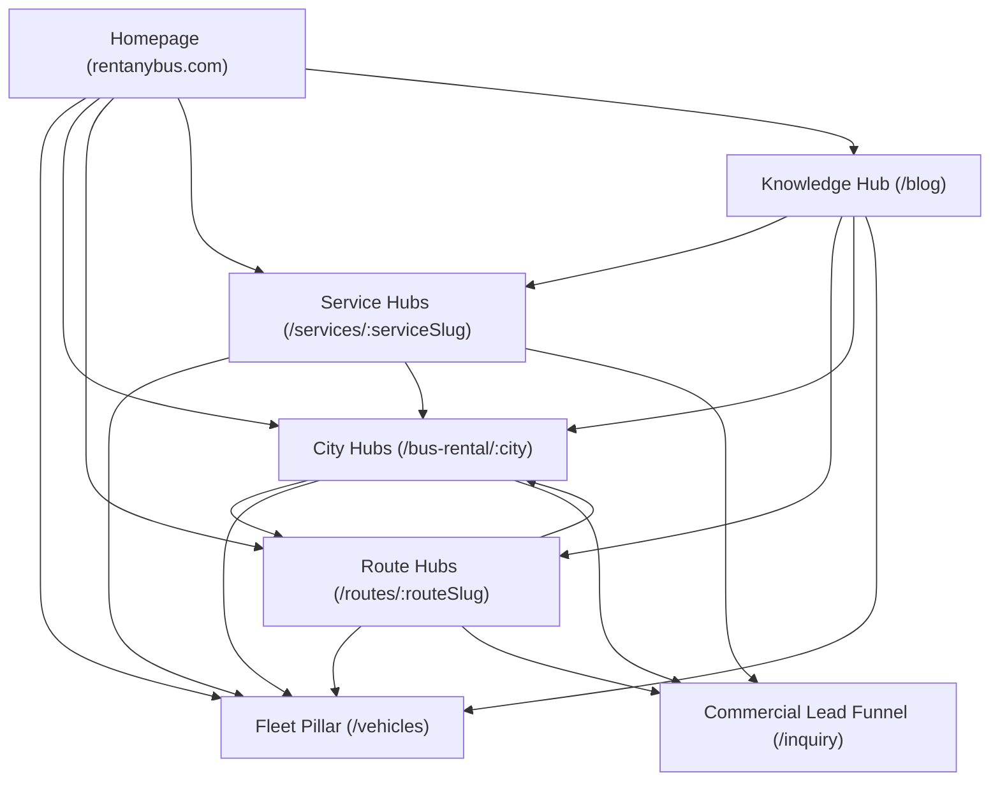

# INTERNAL LINKING BLUEPRINT: RENTANYBUS.COM

## 1. HUB-AND-SPOKE ARCHITECTURAL MODEL

The RentAnyBus internal linking architecture is structured into a clean, hierarchical **Topic Cluster (Hub-and-Spoke)** network. This prevents orphaned pages, preserves crawl equity, and funnels authority directly from informational search queries down to commercial conversion landing pages.

---

## 2. LINKING MESH & EXACT ANCHOR TEXT MATRIX

### Pillar 1: Homepage (`/`)
* **Outbound Target Pages & Exact Anchor Text:**
  * To `/vehicles`: `"Explore Verified Fleet"`, `"Browse 12–55 Seater Fleet"`
  * To `/bus-rental/bhubaneswar`: `"Bus Rental in Bhubaneswar"`
  * To `/bus-rental/cuttack`: `"Bus Rental in Cuttack"`
  * To `/bus-rental/puri`: `"Bus Rental in Puri"`
  * To `/services/wedding-bus-rental`: `"Wedding & Marriage Fleet"`
  * To `/services/pilgrimage-bus-rental`: `"Tirth Yatra & Pilgrimages"`
  * To `/services/corporate-bus-rental`: `"Corporate Tours & Commute"`
  * To `/blog/bus-rental-cost-per-km-odisha-price-guide`: `"Bus Rental Cost per Km in Odisha"`

---

### Pillar 2: Fleet Catalog (`/vehicles`) & Vehicle Details (`/vehicles/:id`)
* **Inbound Sources:** Homepage hero, Header navigation, Footer, City Hubs, Blog guide CTA banners.
* **Contextual Outbound Links & Anchor Text:**
  * To `/bus-rental/bhubaneswar`: `"available for Bhubaneswar local & outstation trips"`
  * To `/bus-rental/puri`: `"ideal for Puri Jagannath Dham yatra"`
  * To `/services/wedding-bus-rental`: `"popular for wedding Barat convoys"`
  * To `/inquiry?vehicleId=:id`: `"Request Instant Quote for this Vehicle"`

---

### Pillar 3: Regional City Hubs (`/bus-rental/:city`)
Each city hub acts as a local commercial epicenter:
* **Target URLs:**
  * `/bus-rental/bhubaneswar`
  * `/bus-rental/cuttack`
  * `/bus-rental/puri`
  * `/bus-rental/berhampur`
  * `/bus-rental/balasore`
  * `/bus-rental/sambalpur`
  * `/bus-rental/rourkela`
* **Contextual Outbound Links & Anchor Text:**
  * From `/bus-rental/bhubaneswar` -> To `/routes/bhubaneswar-to-puri`: `"Bhubaneswar to Puri same-day bus hire"`
  * From `/bus-rental/bhubaneswar` -> To `/routes/bhubaneswar-to-konark`: `"excursion to Konark Sun Temple"`
  * From `/bus-rental/bhubaneswar` -> To `/routes/bhubaneswar-to-chilika`: `"Satapada & Barkul Chilika Lake tour"`
  * From `/bus-rental/cuttack` -> To `/routes/cuttack-to-puri`: `"Cuttack to Puri Jagannath Temple bus rental"`
  * From `/bus-rental/berhampur` -> To `/routes/bhubaneswar-to-gopalpur`: `"Gopalpur-on-Sea & Tampara Lake transport"`
  * To `/inquiry?city=:city`: `"Get Instant Quote in [City]"`

---

### Pillar 4: High-Volume Route Hubs (`/routes/:routeSlug`)
* **Target URLs:**
  * `/routes/bhubaneswar-to-puri`
  * `/routes/bhubaneswar-to-konark`
  * `/routes/bhubaneswar-to-chilika`
  * `/routes/cuttack-to-puri`
  * `/routes/bhubaneswar-to-gopalpur`
* **Contextual Outbound Links & Anchor Text:**
  * To `/bus-rental/bhubaneswar`: `"Bhubaneswar bus rental fleet"`
  * To `/bus-rental/puri`: `"Puri temple drop-off guidelines"`
  * To `/services/pilgrimage-bus-rental`: `"senior citizen pilgrim charter assistance"`
  * To `/vehicles`: `"browse available tempo travellers and coaches"`

---

### Pillar 5: Commercial Service & Use-Case Hubs (`/services/:serviceSlug`)
* **Target URLs:**
  * `/services/wedding-bus-rental`
  * `/services/corporate-bus-rental`
  * `/services/pilgrimage-bus-rental`
  * `/services/airport-transfer`
* **Contextual Outbound Links & Anchor Text:**
  * To `/bus-rental/bhubaneswar`: `"Bhubaneswar wedding mandap shuttles"`
  * To `/bus-rental/cuttack`: `"Millennium City Barat convoys in Cuttack"`
  * To `/blog/wedding-bus-rental-size-guide-odisha`: `"How to choose the right bus size for an Indian wedding"`
  * To `/inquiry?service=:serviceName`: `"Request Customized Quote"`

---

### Pillar 6: Educational Blog & Guides Hub (`/blog`)
Cornerstone informational articles rank for informational intent and channel commercial link juice downward:
* **Articles:**
  * `/blog/bus-rental-cost-per-km-odisha-price-guide` (1,200+ words)
  * `/blog/wedding-bus-rental-size-guide-odisha`
  * `/blog/puri-jagannath-yatra-bus-booking-guide`
* **Contextual In-Article Outbound Links & Anchor Text:**
  * In Pricing Guide -> To `/vehicles`: `"browse verified tempo travellers & coaches"`
  * In Pricing Guide -> To `/inquiry`: `"request an all-inclusive digital quote"`
  * In Pricing Guide -> To `/routes/bhubaneswar-to-puri`: `"Bhubaneswar to Puri round-trip charter"`
  * In Wedding Guide -> To `/services/wedding-bus-rental`: `"dedicated wedding Barat bus rental packages"`
  * In Pilgrim Guide -> To `/services/pilgrimage-bus-rental`: `"Jagannath Puri Yatra charter coaches"`

---

## 3. ANTI-SPAM & USER EXPERIENCE SAFEGUARDS

1. **No Keyword Stuffing in Anchors:** Every anchor is grammatically integrated into natural, reader-friendly sentences rather than raw standalone keyword repetitions.
2. **Breadcrumb Hierarchy Everywhere:** Every single page includes `<BreadcrumbList>` schema and UI breadcrumb navigation, giving search crawlers clear parent-child context:
   `Home > Services > Wedding Bus Rental` or `Home > Routes > Bhubaneswar to Puri`.
3. **Structured Footer Linking:** The footer groups links into clean, discrete categories (Company, Services, Cities, Routes & Portals), with zero hidden links, no spam networks, and no doorway pages.
4. **Rel NoFollow / NoIndex for Non-Indexable Pages:** Administrative panels (`/admin*`), customer profiles (`/profile`), and authenticated owner dashboards (`/owner/dashboard`) are blocked from consuming crawl budget via `robots.txt` and `<meta name="robots" content="noindex, nofollow" />`.
