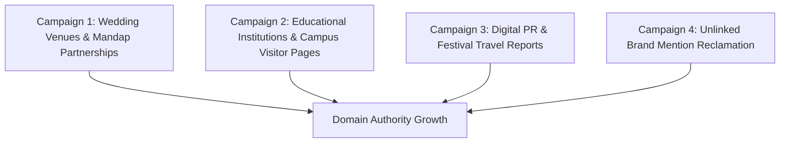

# WHITE-HAT LINK BUILDING & DIGITAL PR PLAYBOOK: RENTANYBUS.COM

## 1. STRATEGIC OVERVIEW

To dominate competitive commercial keywords without risking Google algorithmic penalties (Penguin, Helpful Content System), **RentAnyBus must strictly avoid purchased link packages, PBNs (Private Blog Networks), and automated forum spam**. 

Our off-page strategy focuses exclusively on high-relevance, natural, relationship-driven backlinks within the Odisha geographic and travel ecosystem:



---

## 2. CAMPAIGN 1: WEDDING MANDAPS & CONVENTION CENTER PARTNERSHIPS

### Target Audience
Top luxury wedding venues, convention centers, and marriage mandaps in Bhubaneswar and Cuttack (e.g., Mayfair Lagoon, Swosti Premium, Sandy’s Tower, Railway Officers Mandap, Utkal Mandap, Barabati Stadium Club banquet).

### Strategic Value
Most venue websites feature a **"How to Reach / Guest Accommodations / Preferred Vendors"** page for out-of-town hosts. Securing a listing as their verified passenger transit partner drives ultra-targeted referral leads and strong local link equity.

### Outreach Email Template:
```text
Subject: Preferred Guest Transport & Bus Charter Partnership — [Venue Name] x RentAnyBus

Dear [Venue Events Director / General Manager Name],

We hope you are having a wonderful wedding season at [Venue Name].

At RentAnyBus (Odisha's verified bus and tempo traveller charter marketplace), we frequently coordinate guest shuttles and wedding barat buses arriving at [Venue Name] from Biju Patnaik International Airport and outstation locations.

We notice your website has a helpful "Visitor Information & Preferred Vendors" section for wedding families. 

We would love to provide [Venue Name] clients with guaranteed priority dispatch, discounted corporate rates, and dedicated coordinator assistance for their guest logistics. 

Would you be open to listing RentAnyBus as a verified group transport partner on your vendor resources page? In return, we actively recommend [Venue Name] across our wedding guide (https://www.rentanybus.com/services/wedding-bus-rental) which reaches over 10,000 monthly event planners in Odisha.

Let us know if you'd be available for a brief 5-minute call this week.

Warm regards,
[Name]
Fleet Partnerships Director | RentAnyBus
Phone: +91 82495 29220 | Website: https://www.rentanybus.com
```

---

## 3. CAMPAIGN 2: EDUCATIONAL INSTITUTION & UNIVERSITY VISITOR GUIDES

### Target Audience
Universities and colleges in the Bhubaneswar/Cuttack educational hub:
* Kalinga Institute of Industrial Technology (KIIT)
* Siksha 'O' Anusandhan (SOA / ITER)
* IIT Bhubaneswar (Argul campus)
* AIIMS Bhubaneswar
* Ravenshaw University (Cuttack)
* Xavier Institute of Management (XIMB)

### Strategic Value
University websites frequently maintain **"Campus Visit / How to Reach / Local Transit"** guides for visiting parents, national conference delegates, and student study tours. These `.ac.in` or `.edu.in` links carry immense domain trust.

### Outreach Angle:
Provide an embeddable, free "Campus Group Transit & Airport Shuttle Guide for Students & Parents", linking back to `/services/airport-transfer` and `/bus-rental/bhubaneswar`.

---

## 4. CAMPAIGN 3: DIGITAL PR & REGIONAL FESTIVAL TRAVEL TRENDS

### Target Media Outlets
Odisha state media desks, travel lifestyle sections, and regional digital publications:
* Sambad English / Kanak News Digital
* Odisha Bytes / Bhubaneswar Buzz
* Pragativadi
* The Pioneer (Odisha Edition)
* Times of India (Bhubaneswar Metro Desk)

### High-Authority Digital PR Pitch Angles:
1. **The Annual Rath Yatra Pilgrim Mobility Report:**
   * *Headline Pitch:* *"Rath Yatra 2026: Private Charter Demand Surges 340% as Senior Devotees Prioritize Direct Temple Shuttles."*
   * *Deliverable:* Publish proprietary booking data from RentAnyBus analyzing travel patterns from West Bengal, Jharkhand, and Andhra Pradesh into Puri.
2. **Bali Jatra Intercity Transit Trends:**
   * *Headline Pitch:* *"Bhubaneswar-Cuttack Twin City Travel: How Group Charters Cut Parking Congestion During Historic Bali Jatra."*
3. **Eco-Tourism & Chilika Dolphin Sanctuary Excursions:**
   * Pitch our comprehensive guide on sustainable group bus travel to Satapada and Mangalajodi bird sanctuary.

### Media Pitch Template:
```text
Subject: DATA STORY: Rath Yatra 2026 Charter Bus Demand Surges 340% Across Odisha

Hi [Journalist Name],

With Shree Jagannath Rath Yatra approaching, state transportation is seeing historic shifts in pilgrim travel patterns.

According to 2026 booking data from RentAnyBus (Odisha's regional bus rental network):
- Demand for senior-friendly 17-seater Tempo Travellers and pushback buses has surged 340% compared to last season.
- Inter-state bookings originating from Kolkata, Raipur, and Visakhapatnam direct to Puri have doubled.
- Families are increasingly choosing private group charters over fragmented transit to avoid congestion at Malatipatpur.

We have compiled a complete statistical briefing with infographic charts breaking down route costs, average group sizes, and key passenger demographics.

Would this be of interest for your upcoming travel or local mobility feature in [Publication Name]? Happy to provide exclusive quotes and high-res data graphics.

Best regards,
[Name] | Media Desk, RentAnyBus
Contact: +91 82495 29220 | https://www.rentanybus.com
```

---

## 5. CAMPAIGN 4: UNLINKED BRAND MENTION RECLAMATION

### Process
1. Set up **Google Alerts** and **Talkwalker Alerts** for `"RentAnyBus"` and `"Rent Any Bus"`.
2. Monitor regional travel blogs, Facebook groups, and event discussion forums.
3. When a journalist, blogger, or wedding coordinator mentions RentAnyBus without hyperlinking the brand, send a polite 2-line reclamation email:

```text
Hi [Author Name],

Thank you for mentioning RentAnyBus in your recent feature on "[Article Title]"!

Would you mind hyperlinking our name to https://www.rentanybus.com so your readers can easily access our verified fleet listings and pricing guides?

We really appreciate your support for homegrown Odisha startups!

Best,
[Name] | RentAnyBus Team
```

---

## 6. MONTHLY BACKLINK ACQUISITION TARGETS

| Timeframe | Target New Linking Domains | Primary Focus |
| :--- | :--- | :--- |
| **Month 1 (Days 1–30)** | 10–15 | Local NAP business directories (Justdial, Sulekha, IndiaMART, TradeIndia, Google Business Profile) |
| **Month 2 (Days 31–60)** | 5–8 | Wedding venues, event planners, and local travel blog resources |
| **Month 3 (Days 61–90)** | 3–5 | University visitor pages, digital PR media pickups, and Odisha tourism community links |
| **Target DR by Day 90** | **DR 25+** | High-quality contextual backlinks with 100% natural anchor text distribution |
